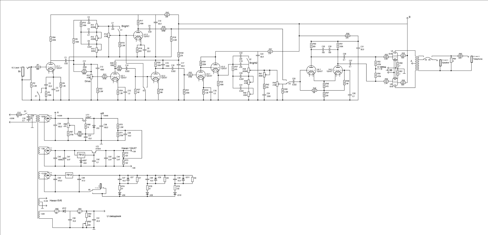

# Принципиальная схема

`schematic.jpg` — актуальная принципиальная схема усилителя.

**Состав сигнального тракта:** V1–V4 (12AX7) — предусилитель и фазоинвертор,
V5/V6 (6V6) — двухтактный выходной каскад. Переключение каналов и режима
наушников — на реле K1–K9.

**Питание:** анодное +430 В / +344 В, стабилизированный накал 12AX7 (+12 В),
накал 6V6 ~6,3 В, отдельный источник напряжения смещения.

Здесь же размещаются: исходники схемы в CAD, версии с внесёнными изменениями,
расчёты режимов каскадов.
